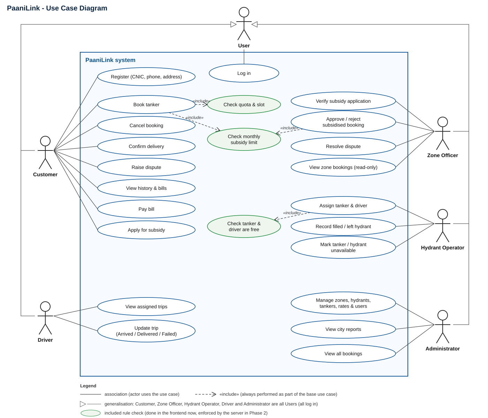
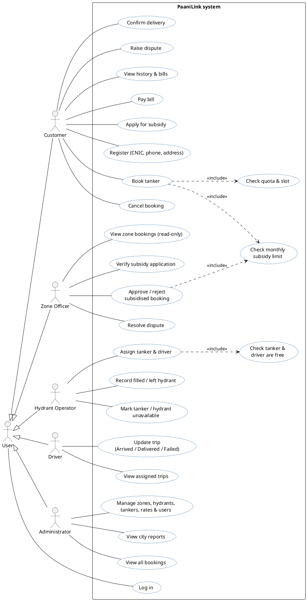

# PaaniLink – Use Case Diagram

The SVG opens in any browser and can be inserted into Word/PowerPoint. The PlantUML source
at the end draws the same diagram (paste it into https://www.plantuml.com/plantuml or a PlantUML plugin).

## Actors

| Actor | Description |
|---|---|
| User | Any person with an account. All other actors are Users and can **Log in**. |
| Customer | Resident or institution that books tankers. Registers with CNIC, phone and address. |
| Zone Officer | Water Board officer for one zone. Verifies subsidy and approves subsidised bookings, resolves disputes. |
| Hydrant Operator | Runs one hydrant. Assigns tankers and drivers, records filling and departure. |
| Driver | Drives a tanker and updates trips assigned to them. |
| Administrator | Manages master data and accounts, sees city-wide reports. |

## Use cases

| # | Use case | Actor | Short description | Page |
|---|---|---|---|---|
| UC1 | Log in | User | Email + password; gets a token and is sent to the page for their role. | index.html |
| UC2 | Register | Customer | Creates a customer account with name, CNIC, phone, email, zone, address, password. | register.html |
| UC3 | Book tanker | Customer | Chooses type, hydrant serving their zone, date, slot, size, address. Includes UC20 and (for subsidised) UC21. | book.html |
| UC4 | Cancel booking | Customer | Cancels before the tanker is filled; bill becomes Void. | booking.html / bookings.html |
| UC5 | Confirm delivery | Customer | Confirms a Delivered booking (closes it). | booking.html |
| UC6 | Raise dispute | Customer | Disputes a Delivered or Failed booking with a written reason. | booking.html |
| UC7 | View history & bills | Customer | Lists own bookings with full status history, and own bills. | bookings.html, booking.html, bills.html |
| UC8 | Pay bill | Customer | Marks an Unpaid bill as Paid with a payment method (simulated). | bills.html |
| UC9 | Apply for subsidy | Customer | Submits category, proof type and reference, income/household size or institution name. | subsidy-apply.html |
| UC10 | Verify subsidy application | Zone Officer | Approves (sets monthly gallon limit) or rejects (with remarks) applications from their zone. | subsidy-review.html |
| UC11 | Approve / reject subsidised booking | Zone Officer | Approves or rejects PendingApproval bookings in their zone. Includes UC21. | bookings.html, booking.html |
| UC12 | Resolve dispute | Zone Officer | Chooses an outcome (Refund / Redelivery arranged / No action) and writes the decision. | disputes.html |
| UC13 | View zone bookings (read-only) | Zone Officer | Sees all bookings and trips of the zone; cannot dispatch or change the driver. | bookings.html, booking.html |
| UC14 | Assign tanker & driver | Hydrant Operator | Picks a free tanker of the right size and a free driver for an Approved booking (can re-assign before filling). Includes UC22. | operator.html |
| UC15 | Record filled / left hydrant | Hydrant Operator | Marks the tanker Filled, then Left hydrant (Dispatched). | operator.html |
| UC16 | Mark tanker / hydrant unavailable | Hydrant Operator | Takes a tanker or the whole hydrant out of service (hydrant needs a reason). | fleet.html |
| UC17 | View assigned trips | Driver | Sees only their own trips, today and upcoming. | driver.html |
| UC18 | Update trip | Driver | Marks Arrived, Delivered or Failed (reason required). | driver.html |
| UC19 | Manage zones, hydrants, tankers, rates & users | Administrator | Create, edit, deactivate master data and staff accounts. | admin-*.html |
| UC23 | View city reports | Administrator | Bookings by status/type/zone, hydrant quota usage, revenue, fail reasons, disputes. | reports.html |
| UC24 | View all bookings | Administrator | City-wide booking list with search, filters, sorting, paging. | bookings.html |

**Included use cases** (always run as part of the base use case):

| # | Included use case | Used by | What it checks |
|---|---|---|---|
| UC20 | Check quota & slot | UC3 | Hydrant available, slot inside hydrant hours and not over, enough daily quota left. |
| UC21 | Check monthly subsidy limit | UC3, UC11 | Customer is approved for subsidy and the booking fits in the remaining monthly gallons. |
| UC22 | Check tanker & driver are free | UC14 | Same capacity, tanker available, driver active, neither already booked in that date + slot. |

## PlantUML source

